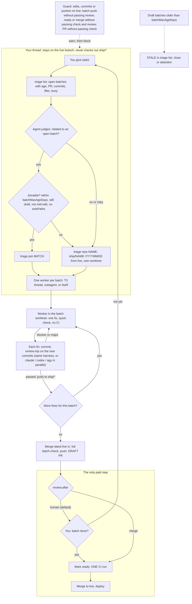

# batchship

Pay for CI once per batch of fixes, not once per fix. Made for coding agents (Claude Code, T3, Codex, Antigravity) and the people who run them.

## Install

Pick your agent, then run `init` once per repo (all agents):

| Agent | Install the plugin (skill) |
|---|---|
| Claude Code | `/plugin marketplace add klovr-co/batchship` then `/plugin install batchship@batchship` |
| Codex | `codex plugin marketplace add klovr-co/batchship` then `codex plugin add batchship@batchship` |
| Antigravity (agy) | `agy plugin install https://github.com/klovr-co/batchship` |

Per repo, from the repo root (needs Node and a clone of this repo, or the installed plugin directory):

    node <path-to-batchship>/scripts/init.mjs

For a repo where `staging` is live and `main` is only touched by a human: `init --protected staging --manual main`.

`init` writes `.batchship/` (the scripts), `.ship.json`, `BATCH.md`, a PR template, a batch section in `AGENTS.md` (and `@AGENTS.md` in `CLAUDE.md`, since Claude Code reads only that), a git `pre-push` hook, and per-agent hook files: `.agents/hooks.json` (Antigravity) and `.codex/hooks.json` (Codex); the Claude Code hook ships in the plugin. It never overwrites existing files. Then run `/ship-batch setup` or edit `.ship.json` so `checks` match your CI jobs.

Already set up, new plugin version: `init --update` refreshes `.batchship/`, `BATCH.md` and the `AGENTS.md` section, and keeps `.ship.json`.

## How it works

A batch is a temporary integration branch, `ship/<name>-<YYYYMMDD>`. Fixes pile up on it with no CI, each one reviewed by agents before it is pushed. When the batch is done you mark its draft PR ready once (the only paid run) and merge, or let the agent do that when `review.after` is `merge`. The agent decides what goes together; the scripts only enforce the limits.

## Settings (`.ship.json`)

| Key | Default | Meaning |
|---|---|---|
| `protectedBranch` | `main` | The live branch batches land on |
| `manualBranches` | `[]` | Human-only branches (e.g. `["main"]` when `staging` is live) |
| `guardMode` | `warn` | `block` makes the guard deny instead of warn |
| `checks` | detected | Fast local stand-ins for CI: `{ name, cmd, cwd?, paths?, quick? }` |
| `batchMaxAgeDays` | `7` | Older batches are never joined |
| `soloPaths` | `[]` | Path prefixes (e.g. `[".github/"]`) that must ship in a batch of their own |
| `setup` | auto | Command run in a new batch worktree; default installs with the detected package manager |
| `review.reviewers` | `["same"]` | Agents that review each fix before it is pushed to the batch, in parallel and read-only: `same` (the agent's own harness), `claude`, `codex`, `agy`, each optionally `:model`, or `{ "name", "cmd" }`. `[]` turns review off |
| `review.rounds` | `2` | Failed reviews in a row before the batch goes back to you |
| `review.after` | `human` | `human`: stop at the draft PR. `merge`: once check and review pass, the agent marks it ready, waits for CI and merges |
| `review.focus` | `""` | Extra review instructions for every batch |
| `review.timeoutMinutes` | `20` | Per reviewer |

## What each layer covers

| Layer | Covers |
|---|---|
| Plugin hook (`hooks/hooks.json`) | Claude Code (tested): denies file edits and commits on the live or manual branches ("triage first"), pushes to them, `gh pr ready`, `gh pr merge`, non-draft PRs, and PRs without a passing local check; pushes to a batch branch whose HEAD has not passed review; with `review.after: "merge"`, ready and merge are allowed only from a batch worktree whose HEAD passed check and review. Silent in repos without `.ship.json` |
| `.agents/hooks.json` | Antigravity: same guard for shell commands, agy hook protocol (unit-tested; not run inside agy). File edits are not seen |
| `.codex/hooks.json` | Codex: same guard. **Did not fire in a live test**; rely on `AGENTS.md` and `pre-push` |
| `.github/workflows/batch-branch-check.yml` | GitHub, any agent or person: flags a ready PR to the live branch whose head is not `ship/*` or `hotfix/*`. Starts as a warning; set `SHIP_ENFORCE` to `"1"` to fail it |
| `/ship-batch` skill, `AGENTS.md`, `BATCH.md` | The triage, hand-off and worker steps, for every agent |
| `batch-check` | Local checks, plus the `soloPaths` rule |
| `review.mjs` | Agent code review of each fix (only the commits since the last pass); writes the result the guard reads |
| git `pre-push` hook | Any agent or human |

The hook starts in `warn` mode; switch to `block` once you trust it.

## Try it

    playground/setup.sh            # throwaway repo in /tmp with a local origin, guard on block
    cd /tmp/batchship-playground/app && claude

Give it a few fixes from `main` and watch it triage, open worktrees and stop at the draft PR. No GitHub remote, so `gh pr create` itself cannot run there.

## Test

    node --test 'scripts/tests/*.test.mjs'

Not built yet: release-gate workflow and the `ci-health` report (see the spec).
