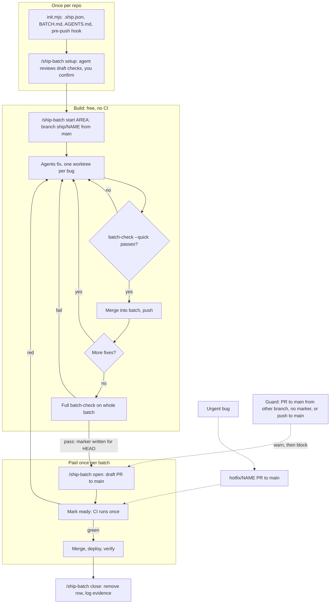

# batchship

Pay for CI once per batch of fixes, not once per fix. Made for coding agents (Claude Code, delegated children, Codex) and the people who run them.

## Install

Pick your agent, then run `init` once per repo (all agents):

| Agent | Install the plugin (skill) |
|---|---|
| Claude Code | `/plugin marketplace add klovr-co/batchship` then `/plugin install batchship@batchship` |
| Codex | `codex plugin marketplace add klovr-co/batchship` then `codex plugin add batchship@batchship` |
| Antigravity (agy) | `agy plugin install https://github.com/klovr-co/batchship` |

Per repo, from the repo root (needs Node and a clone of this repo, or the installed plugin directory):

    node <path-to-batchship>/scripts/init.mjs

For a repo where `staging` is live and `main` is only touched by a human: `init --protected staging --manual main`.

`init` writes `.batchship/` (the scripts), `.ship.json`, `BATCH.md`, a PR template, three lines in `AGENTS.md`, a git `pre-push` hook, and per-agent hook files: `.claude`-plugin hook is in the plugin, `.agents/hooks.json` (Antigravity) and `.codex/hooks.json` (Codex). It never overwrites existing files. Then run `/ship-batch setup` or edit `.ship.json` so `checks` match your CI jobs.

## How it works

## What each layer covers

| Layer | Covers |
|---|---|
| Plugin hook (`hooks/hooks.json`) | Claude Code (tested): blocks `gh pr create/ready` to `main` outside `ship/*` / `hotfix/*` or without a passing local check; blocks push to `main` |
| `.agents/hooks.json` | Antigravity: same guard, agy hook protocol (unit-tested; not run inside agy) |
| `.codex/hooks.json` | Codex: same guard. **Did not fire in a live test**; the repo may need to be trusted first. Rely on `AGENTS.md` (verified: Codex refused a push to `main`) and `pre-push` |
| `.github/workflows/batch-branch-check.yml` | GitHub, any agent or person: flags a ready PR to `main` whose head is not `ship/*` or `hotfix/*` (or comes from a fork). Starts as a warning; set `SHIP_ENFORCE` to `"1"` to fail it. Not yet run on GitHub. |
| `/ship-batch` skill | start, check, open, close, status |
| `AGENTS.md` + `BATCH.md` prompt block | Other agents and delegated children |
| git `pre-push` hook | Any agent or human |

The hook starts in `warn` mode (`guardMode` in `.ship.json`); switch to `block` after a week.

## Test

    node --test 'scripts/tests/*.test.mjs'

Not built yet: release-gate workflow and the `ci-health` report (see the spec).
