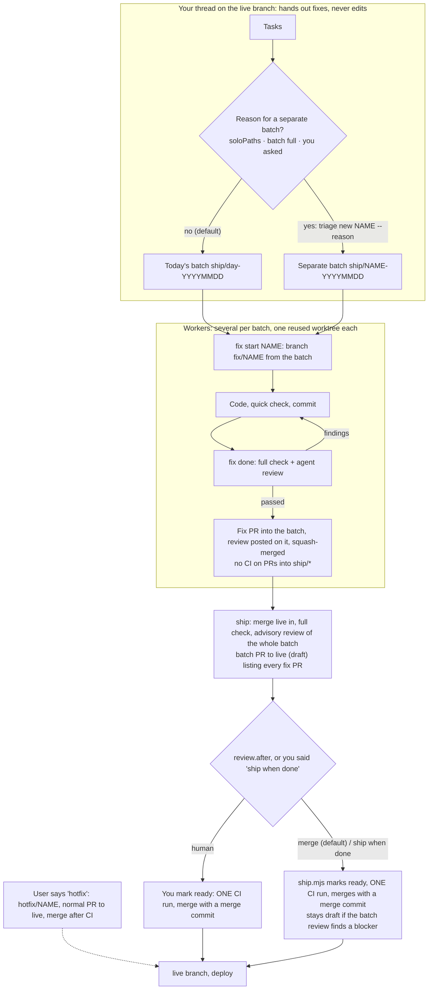

# batchship

Pay for CI once per batch of fixes, not once per fix. Made for coding agents (Claude Code, T3, Codex, Antigravity) and the people who run them.

## Install

Pick your agent, then run `init` once per repo (all agents):

| Agent | Install the plugin (skill) |
|---|---|
| Claude Code | `/plugin marketplace add klovr-co/batchship` then `/plugin install batchship@batchship` |
| Codex | `codex plugin marketplace add klovr-co/batchship` then `codex plugin add batchship@batchship` |
| Antigravity (agy) | `agy plugin install https://github.com/klovr-co/batchship` |

Per repo, from the repo root (needs Node and a clone of this repo, or the installed plugin directory):

    node <path-to-batchship>/scripts/init.mjs

For a repo where `staging` is live and `main` is only touched by a human: `init --protected staging --manual main`.

`init` writes `.batchship/` (the scripts), `.ship.json`, `BATCH.md`, a PR template, a batch section in `AGENTS.md` (and `@AGENTS.md` in `CLAUDE.md`, since Claude Code reads only that), a git `pre-push` hook, and per-agent hook files: `.agents/hooks.json` (Antigravity) and `.codex/hooks.json` (Codex); the Claude Code hook ships in the plugin. It never overwrites existing files. Then run `/ship-batch setup` or edit `.ship.json` so `checks` match your CI jobs.

Already set up, new plugin version: `init --update` refreshes `.batchship/`, `BATCH.md` and the `AGENTS.md` section, and keeps `.ship.json`. Until then, the guard points at the plugin's own scripts and says the repo's copy is behind.

CI must run only on PRs to the live branch (`pull_request: branches: [main]`), or fix PRs into `ship/*` will cost CI; `fix.mjs done` warns when it does not.

## How it works

One PR per fix, one CI run per batch. A batch is a temporary integration branch: today's is `ship/day-<YYYYMMDD>`. Each fix gets its own branch and PR into the batch, reviewed by agents, with no CI (CI runs only on PRs to the live branch). When the batch ships, one PR goes to the live branch and CI runs once. Fixes join today's batch unless there is a stated reason not to.

Red batch CI: re-run only the failed jobs for runner or flaky failures; for a real failure, `git bisect run <test>` over the batch (one commit per fix) finds the fix, then fix forward or `fix.mjs eject <PR>`.

## Commands

| Command | Who | Does |
|---|---|---|
| `triage.mjs list` | Your thread | Batches, their fixes, and what shipping them costs |
| `fix.mjs start <name> [--batch B]` | Worker | Branch `fix/<name>` from today's batch (or B) in an idle worker worktree |
| `fix.mjs done [--title ..] [--focus ..]` | Worker | Full check, agent review, fix PR into the batch with the review on it, squash-merge |
| `fix.mjs adopt <name>` | Worker | Make the branch you are on a fix for today's batch |
| `triage.mjs new <name> --reason ".."` | Your thread | A separate batch, with the reason recorded in its PR |
| `ship.mjs [<batch>] [--merge]` | Your thread | The batch PR to the live branch; with `review.after: merge` (default) it marks it ready, waits for CI and merges. `--merge` (when you asked to ship) does so even under `human` |
| `fix.mjs eject <PR>` | Your thread | Revert one fix out of its batch |
| `triage.mjs hotfix <name>` | Your thread | `hotfix/<name>` from the live branch: a normal PR, merged after CI, when you asked for a hotfix |

Batches ship once a day by default. Two ways to go faster, in a Claude Code session:
- **Ship when done:** give your list and add "then ship when done" (or "ship after these", "ship it once they're finished"). Your thread finishes every fix, then ships the batch: ready, one CI run, merge.
- **Hotfix:** start a line with `hotfix: <what is broken>`. The agent makes a `hotfix/*` branch from the live branch, opens a normal PR, waits for CI and merges it, skipping the batch.

A prompt hook records the request for that session for two hours, and each one opens only its own path. Talking about it, asking a question about it, or quoting it does not count, and agents cannot unlock it themselves. The guard stops agents from taking these steps by mistake; it is not a security boundary.

## Settings (`.ship.json`)

| Key | Default | Meaning |
|---|---|---|
| `protectedBranch` | `main` | The live branch batches land on |
| `manualBranches` | `[]` | Human-only branches (e.g. `["main"]` when `staging` is live) |
| `guardMode` | `warn` | `block` makes the guard deny instead of warn |
| `checks` | detected | Fast local stand-ins for CI: `{ name, cmd, cwd?, paths?, quick? }` |
| `batchMaxAgeDays` | `0` | Days a batch takes new fixes; `0` = only the day it is dated (one batch per day) |
| `batchMaxFiles` | `40` | Changed files (lockfiles aside) at which a batch is full; `0` = no cap |
| `soloPaths` | `[]` | Path prefixes (e.g. `[".github/"]`) that must ship in a batch of their own |
| `setup` | auto | Command run in a new worker or hotfix worktree; default installs with the detected package manager |
| `review.reviewers` | `["same"]` | Agents that review each fix before it joins the batch, in parallel and read-only: `same` (the agent's own harness), `claude`, `codex`, `agy`, each optionally `:model`, or `{ "name", "cmd" }`. `[]` turns review off |
| `review.rounds` | `2` | Failed reviews in a row before the fix goes back to you |
| `review.after` | `merge` | `merge`: ship.mjs marks the batch PR ready, waits for CI and merges it, unless the whole-batch review finds a blocker or major issue. `human`: the batch PR waits for you. Read from the live branch, so a batch cannot change it |
| `review.focus` | `""` | Extra review instructions for every fix |
| `review.timeoutMinutes` | `20` | Per reviewer |

## What each layer covers

| Layer | Covers |
|---|---|
| Plugin hooks (`hooks/hooks.json`) | Claude Code (tested): denies file edits and commits on the live or manual branches, pushes to them or straight to `ship/*`, `gh pr ready` / `gh pr merge` and non-draft PRs to the live branch (unless you asked for a hotfix or to ship in the session), and a batch PR without a passing local check. Records a hotfix or ship request from your prompt. Silent in repos without `.ship.json`; tells a repo when its scripts are older than the plugin |
| `.agents/hooks.json` | Antigravity: same guard for shell commands, agy hook protocol (unit-tested; not run inside agy). File edits are not seen |
| `.codex/hooks.json` | Codex: same guard. **Did not fire in a live test**; rely on `AGENTS.md` and `pre-push` |
| `.github/workflows/batch-branch-check.yml` | GitHub, any agent or person: flags a ready PR to the live branch whose head is not `ship/*` or `hotfix/*`. Starts as a warning; set `SHIP_ENFORCE` to `"1"` to fail it |
| `/ship-batch` skill, `AGENTS.md`, `BATCH.md` | The hand-off, worker and shipping steps, for every agent |
| `batch-check` | Local checks, plus the `soloPaths` rule |
| `fix.mjs`, `ship.mjs` | The steps that matter run as scripts: check, review, fix PR, merge into the batch, batch PR |
| `review.mjs` | Agent code review of each fix, and an advisory review of the whole batch |
| git `pre-push` hook | Any agent or human |

The hook starts in `warn` mode; switch to `block` once you trust it.

## Try it

    playground/setup.sh            # throwaway repo in /tmp with a local origin, guard on block
    cd /tmp/batchship-playground/app && claude

Give it a few fixes from `main` and watch it start fixes, review them and merge them into today's batch. With no GitHub remote, fixes merge into the batch locally instead of through PRs.

## Test

    node --test 'scripts/tests/*.test.mjs'

Not built yet: release-gate workflow and the `ci-health` report (see the spec).
